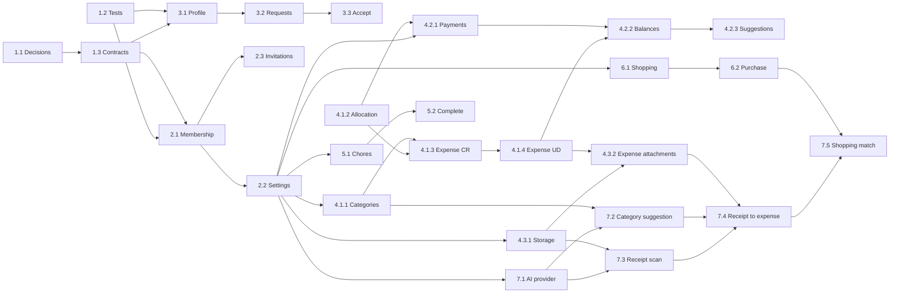

# Backend backlog

This backlog turns the API contracts from [PR #11](https://github.com/diffiii/homesplit/pull/11) and the database mapping from [PR #13](https://github.com/diffiii/homesplit/pull/13) into implementation work. The [backend](../../packages/backend/src) already has NestJS, PostgreSQL/Drizzle, and Better Auth with its organization plugin. Only the auth tables exist, and the app exposes nothing beyond a status endpoint. Application tables, services, controllers, and a backend test workflow are still missing.

The work is grouped into seven epics. Each epic is a folder in [`tasks/`](tasks) with an `x.0-epic.md` overview and numbered subtasks. Expenses has three sub-epics. Attachments (4.3) and AI and receipts (epic 7) are planned for after the core epics.

## Key design decisions

These are proposed directions. Task [1.1](tasks/1-foundation/1.1-decisions-household-permissions-api.md) records the final decisions, and currency limits are recorded in [4.1.2](tasks/4-expenses/4.1-ledger/4.1.2-allocation-engine.md).

- **Household = organization.** The Better Auth organization ID is `householdId`. Membership and invitations are reused; module flags go in a separate organization-keyed table.
- **Access.** Every household route checks membership of the requested household. Members can perform everyday operations; owners and admins change settings.
- **Disabled module = read-only.** Data is kept, reads are allowed, and new mutations are rejected.
- **Financial history is preserved.** A member who leaves stays attributed on past expenses and payments, with no cascading deletes from auth tables.
- **Money.** Integer minor units, exact arithmetic, and deterministic remainder allocation. The backend calculates splits and stores them with the expense in one transaction.
- **Balances** are computed per currency from expenses and recorded payments, with no cached table at first. A settlement records a payment made outside HomeSplit.
- **Lists** use deterministic ordering with an ID tie-breaker and the contracted pagination defaults.

Example: A pays 6,000 and B pays 3,000 for an expense split equally between A, B, and C. Balances are A `+3,000`, B `0`, C `-3,000`. A recorded payment of 3,000 from C to A brings all balances to zero. Amounts in another currency never offset each other.

## Epics

1. [Foundation](tasks/1-foundation/1.0-epic.md): [1.1 Decisions](tasks/1-foundation/1.1-decisions-household-permissions-api.md), [1.2 Test infrastructure](tasks/1-foundation/1.2-test-infrastructure.md), [1.3 Contract validation and errors](tasks/1-foundation/1.3-contract-validation-errors.md)
2. [Households](tasks/2-households/2.0-epic.md): [2.1 Membership and isolation](tasks/2-households/2.1-membership-isolation.md), [2.2 Feature settings](tasks/2-households/2.2-feature-settings.md), [2.3 Email invitations](tasks/2-households/2.3-email-invitations.md)
3. [Users and friends](tasks/3-users-friends/3.0-epic.md): [3.1 Profile](tasks/3-users-friends/3.1-profile-projections.md), [3.2 Friend requests](tasks/3-users-friends/3.2-friend-requests.md), [3.3 Accept and remove](tasks/3-users-friends/3.3-friendships-accept-remove.md)
4. [Expenses](tasks/4-expenses/4.0-epic.md)
   - [4.1 Ledger](tasks/4-expenses/4.1-ledger/4.1.0-epic.md): [4.1.1 Categories](tasks/4-expenses/4.1-ledger/4.1.1-categories.md), [4.1.2 Allocation engine](tasks/4-expenses/4.1-ledger/4.1.2-allocation-engine.md), [4.1.3 Persistence and create/read](tasks/4-expenses/4.1-ledger/4.1.3-expense-persistence-create-read.md), [4.1.4 Update and delete](tasks/4-expenses/4.1-ledger/4.1.4-expense-update-delete.md)
   - [4.2 Settlements](tasks/4-expenses/4.2-settlements/4.2.0-epic.md): [4.2.1 Payments](tasks/4-expenses/4.2-settlements/4.2.1-payments.md), [4.2.2 Balances](tasks/4-expenses/4.2-settlements/4.2.2-balances.md), [4.2.3 Suggestions](tasks/4-expenses/4.2-settlements/4.2.3-suggestions.md)
   - [4.3 Attachments](tasks/4-expenses/4.3-attachments/4.3.0-epic.md): [4.3.1 File storage](tasks/4-expenses/4.3-attachments/4.3.1-file-storage.md), [4.3.2 Expense attachments](tasks/4-expenses/4.3-attachments/4.3.2-expense-attachments.md)
5. [Chores](tasks/5-chores/5.0-epic.md): [5.1 CRUD](tasks/5-chores/5.1-chore-crud.md), [5.2 Complete and reopen](tasks/5-chores/5.2-complete-reopen.md)
6. [Shopping](tasks/6-shopping/6.0-epic.md): [6.1 CRUD](tasks/6-shopping/6.1-shopping-crud.md), [6.2 Purchase and clear](tasks/6-shopping/6.2-purchase-clear.md)
7. [AI and receipts](tasks/7-ai-receipts/7.0-epic.md): [7.1 AI provider](tasks/7-ai-receipts/7.1-ai-provider.md), [7.2 Category suggestions](tasks/7-ai-receipts/7.2-category-suggestions.md), [7.3 Receipt scanning](tasks/7-ai-receipts/7.3-receipt-scanning.md), [7.4 Receipt to expense](tasks/7-ai-receipts/7.4-receipt-expense.md), [7.5 Shopping match](tasks/7-ai-receipts/7.5-shopping-match.md)

## Dependencies

Tasks 1.1, 1.2, and 4.1.2 can start immediately and in parallel. Once 2.2 is done, chores, shopping, friends, and expenses can proceed independently. The longest chain is 4.1.1, then 4.1.3, 4.1.4, 4.2.2, and 4.2.3. Epic 7 builds on expenses, attachments, and shopping; 7.1 and 7.2 can start as soon as 2.2 and 4.1.1 are done.

## Definition of done (every task)

- The task's own migrations are included and apply to an empty database.
- Routes, status codes, and permissions are documented following the conventions from 1.1.
- HTTP integration tests cover happy paths, validation, authorization, and household isolation where relevant.
- Responses match the shared contract schemas.
- Once the last task of an epic is done, update [database-schema.md](../database-schema.md) to mark which proposed tables are implemented.

## Deferred

The following are out of scope and have no contracts yet: notifications (the [placeholder](../../packages/contracts/src/features/notifications/index.ts) is empty), recurring expenses and chores, reminders, budgets, currency conversion, payment-provider transfers, and partial purchases of shopping items. Turning purchases into expenses is covered only through receipts in [epic 7](tasks/7-ai-receipts/7.0-epic.md).
