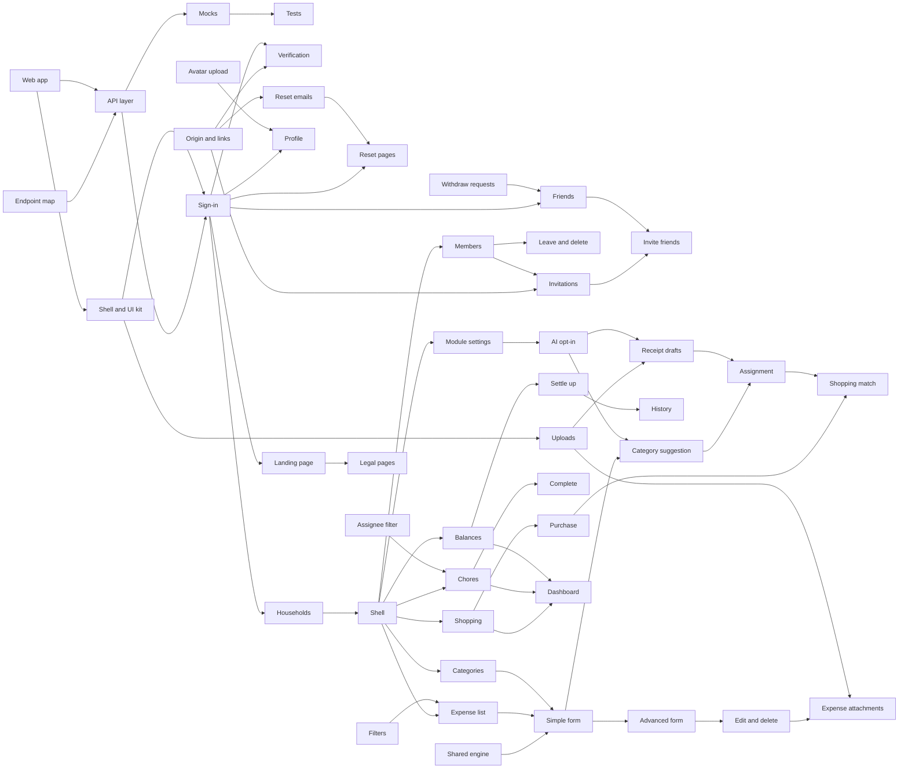

# Frontend backlog

This backlog plans the HomeSplit web app on top of the [API contracts](../../packages/contracts/src), the [decision record](../decisions.md), the [money rules](../money.md), and the backend backlog ([#20](https://github.com/diffiii/homesplit/issues/20)). No frontend exists yet. The contracts cover every core feature except settlement confirmation ([#40](https://github.com/diffiii/homesplit/issues/40)), attachments ([#44](https://github.com/diffiii/homesplit/issues/44)), and receipts ([#55](https://github.com/diffiii/homesplit/issues/55)).

The work is grouped into nine epics. Each epic is a folder in [`frontend-tasks/`](frontend-tasks) with an `x.0-epic.md` overview and numbered tasks. Expenses has three sub-epics. AI and receipts (epic 8) and public pages (epic 9) are planned for after the core epics.

Most tasks are frontend work. A few are small backend or contracts changes the frontend needs; they're labelled `backend` as well and follow the backend definition of done from [#20](https://github.com/diffiii/homesplit/issues/20).

## Key design decisions

- **Platform.** A mobile-first responsive web app, installable as a PWA (manifest and icons only, no service worker or offline mode). Receipt photos use `<input type="file" capture>`. No native app is planned.
- **Stack.** Next.js App Router in `packages/web`, Tailwind, shadcn/ui, and TanStack Query. English only, with no i18n library.
- **Thin Next.js.** Nest is the only API. Next.js holds no business logic and no database access: no server actions and no route handlers. Server components render the layout and redirect signed-out users; household data is fetched in client components with TanStack Query, which handles optimistic toggles and polling.
- **Same-origin API.** The frontend and backend deploy separately (both on Vercel), and Next.js rewrites `/api/*` to the backend. The browser only talks to the frontend origin, so Better Auth's session cookie is first-party on every deployment, including `*.vercel.app` previews, which are separate sites because `vercel.app` is a public suffix. Each Vercel environment points at its own API (production, and a shared staging API for previews).
- **Contracts are the source of truth.** Forms validate with the contract schemas, responses are parsed with them, and an endpoint map in the contracts (1.2) types every route. Expense split previews use the backend's allocation engine, moved into the contracts (1.3), so the preview always equals what the server stores.
- **Follow the backend, but don't wait for it.** Each epic follows its backend epic. Mocks generated from the contracts (1.6) let a task start as soon as its contracts exist; it's done once it also works against the real API.
- **Money.** Amounts stay integer minor units end to end and are formatted with `Intl` using each currency's ISO 4217 exponent, never with floats. The currency picker lists the browser's ISO 4217 codes minus `UNSUPPORTED_CURRENCY_CODES`. The expense form remembers the last currency used in each household on the device, falling back to PLN.
- **Permissions and modules in the UI.** The UI hides what the caller's role can't do and shows disabled modules as read-only, but always handles the server's answer anyway: the [decision record](../decisions.md#roles-and-permissions) stays the authority.
- **Freshness.** No live updates: queries refetch on window focus, and shopping and chore lists also poll while visible.
- **Routes.** Signed-in pages live under `/households/:householdId/...`. Email links use `/invitations/:invitationId`, `/verify-email`, and `/reset-password` (recorded in the decision record by 1.4).

## Epics

1. [Foundation](frontend-tasks/1-foundation/1.0-epic.md): [1.1 Web app](frontend-tasks/1-foundation/1.1-web-app-scaffold.md), [1.2 Endpoint map](frontend-tasks/1-foundation/1.2-endpoint-map.md), [1.3 Shared allocation engine](frontend-tasks/1-foundation/1.3-shared-allocation-engine.md), [1.4 Backend origin and links](frontend-tasks/1-foundation/1.4-backend-origin-links.md), [1.5 API layer](frontend-tasks/1-foundation/1.5-api-layer.md), [1.6 Mocks](frontend-tasks/1-foundation/1.6-contract-mocks.md), [1.7 App shell and UI kit](frontend-tasks/1-foundation/1.7-app-shell-ui-kit.md), [1.8 Tests](frontend-tasks/1-foundation/1.8-test-workflow.md)
2. [Auth and account](frontend-tasks/2-auth-account/2.0-epic.md): [2.1 Sign-up and sign-in](frontend-tasks/2-auth-account/2.1-sign-up-sign-in.md), [2.2 Email verification](frontend-tasks/2-auth-account/2.2-email-verification.md), [2.3 Password reset emails](frontend-tasks/2-auth-account/2.3-password-reset-emails.md), [2.4 Password reset pages](frontend-tasks/2-auth-account/2.4-password-reset-pages.md), [2.5 Avatar upload](frontend-tasks/2-auth-account/2.5-avatar-upload.md), [2.6 Profile and account](frontend-tasks/2-auth-account/2.6-profile-account.md)
3. [Households](frontend-tasks/3-households/3.0-epic.md): [3.1 List and create](frontend-tasks/3-households/3.1-household-list-create.md), [3.2 Household shell](frontend-tasks/3-households/3.2-household-shell.md), [3.3 Members](frontend-tasks/3-households/3.3-members-roles.md), [3.4 Invitations](frontend-tasks/3-households/3.4-invitations.md), [3.5 Leave and delete](frontend-tasks/3-households/3.5-leave-delete.md), [3.6 Module settings](frontend-tasks/3-households/3.6-module-settings.md), [3.7 Dashboard](frontend-tasks/3-households/3.7-dashboard.md)
4. [Friends](frontend-tasks/4-friends/4.0-epic.md): [4.1 Withdraw requests](frontend-tasks/4-friends/4.1-withdraw-friend-requests.md), [4.2 Friends page](frontend-tasks/4-friends/4.2-friends-page.md), [4.3 Invite friends](frontend-tasks/4-friends/4.3-invite-friends.md)
5. [Expenses](frontend-tasks/5-expenses/5.0-epic.md)
   - [5.1 Ledger](frontend-tasks/5-expenses/5.1-ledger/5.1.0-epic.md): [5.1.1 Categories](frontend-tasks/5-expenses/5.1-ledger/5.1.1-categories.md), [5.1.2 List filters](frontend-tasks/5-expenses/5.1-ledger/5.1.2-expense-list-filters.md), [5.1.3 List and detail](frontend-tasks/5-expenses/5.1-ledger/5.1.3-expense-list-detail.md), [5.1.4 Simple form](frontend-tasks/5-expenses/5.1-ledger/5.1.4-expense-form-simple.md), [5.1.5 Advanced form](frontend-tasks/5-expenses/5.1-ledger/5.1.5-expense-form-advanced.md), [5.1.6 Edit and delete](frontend-tasks/5-expenses/5.1-ledger/5.1.6-expense-edit-delete.md)
   - [5.2 Settlements](frontend-tasks/5-expenses/5.2-settlements/5.2.0-epic.md): [5.2.1 Balances](frontend-tasks/5-expenses/5.2-settlements/5.2.1-balances.md), [5.2.2 Settle up](frontend-tasks/5-expenses/5.2-settlements/5.2.2-settle-up.md), [5.2.3 Payment history](frontend-tasks/5-expenses/5.2-settlements/5.2.3-payment-history.md)
   - [5.3 Attachments](frontend-tasks/5-expenses/5.3-attachments/5.3.0-epic.md): [5.3.1 Uploads](frontend-tasks/5-expenses/5.3-attachments/5.3.1-file-upload.md), [5.3.2 Expense attachments](frontend-tasks/5-expenses/5.3-attachments/5.3.2-expense-attachments.md)
6. [Chores](frontend-tasks/6-chores/6.0-epic.md): [6.1 Assignee filter](frontend-tasks/6-chores/6.1-chore-assignee-filter.md), [6.2 Chore list](frontend-tasks/6-chores/6.2-chore-list-editing.md), [6.3 Complete and reopen](frontend-tasks/6-chores/6.3-complete-reopen.md)
7. [Shopping](frontend-tasks/7-shopping/7.0-epic.md): [7.1 Shopping list](frontend-tasks/7-shopping/7.1-shopping-list-editing.md), [7.2 Purchase and clear](frontend-tasks/7-shopping/7.2-purchase-clear.md)
8. [AI and receipts](frontend-tasks/8-ai-receipts/8.0-epic.md): [8.1 AI opt-in](frontend-tasks/8-ai-receipts/8.1-ai-opt-in.md), [8.2 Category suggestions](frontend-tasks/8-ai-receipts/8.2-category-suggestions.md), [8.3 Receipt drafts](frontend-tasks/8-ai-receipts/8.3-receipt-capture-drafts.md), [8.4 Receipt assignment](frontend-tasks/8-ai-receipts/8.4-receipt-assignment.md), [8.5 Shopping match](frontend-tasks/8-ai-receipts/8.5-shopping-match.md)
9. [Public pages](frontend-tasks/9-public-pages/9.0-epic.md): [9.1 Landing page](frontend-tasks/9-public-pages/9.1-landing-page.md), [9.2 Legal pages](frontend-tasks/9-public-pages/9.2-legal-pages.md)

Backend or contracts tasks: 1.2, 1.3, 1.4, 2.3, 2.5, 4.1, 5.1.2, and 6.1.

## Dependencies

1.1, 1.2, 1.3, and 1.4 can start immediately and in parallel. Everything else needs 1.5 and 1.7; feature tasks can then run against the 1.6 mocks as soon as their contracts exist, and each one finishes once its backend task (listed under **Depends on**) is done. Only 5.2.3 (settlement status, [#40](https://github.com/diffiii/homesplit/issues/40)), epic 5.3 (attachment contracts, [#44](https://github.com/diffiii/homesplit/issues/44)), and epic 8 (receipt contracts) have to wait for new contracts.

## Definition of done (every frontend task)

- Every screen has loading, empty, and error states, and errors offer a retry where one makes sense.
- Actions the caller's role can't perform are hidden or disabled, writes in a disabled module are unavailable with a read-only notice, and the server's `FORBIDDEN`, `MODULE_DISABLED`, and `NOT_FOUND` answers are still handled.
- Layouts work from 360 px wide to desktop, in light and dark mode.
- Screens meet WCAG 2.2 AA: keyboard operable, visible focus, labelled controls, sufficient contrast. Component tests run an automated axe check.
- Component tests cover the task's states and validation. The last task of each epic adds a Playwright test for the epic's main flow.
- The task works against the 1.6 mocks and, once its backend task is done, against the real API. Mocks are corrected wherever the real API differs.

Backend and contracts tasks in this backlog follow the definition of done from [#20](https://github.com/diffiii/homesplit/issues/20). Changes to [`decisions.md`](../decisions.md) go in their own PR, as that file requires.

## Proposed change to the backend definition of done

Once 1.2 is done, a backend task that adds or changes a route also updates its entry in the endpoint map.

## Deferred

Out of scope for now: offline support, live updates (websockets or server-sent events), languages other than English and Polish number formatting, a native app, notifications, account deletion (deferred in the decision record), archiving households, free-text expense search, budgets and reports, and the backend's deferred items in [#20](https://github.com/diffiii/homesplit/issues/20).
