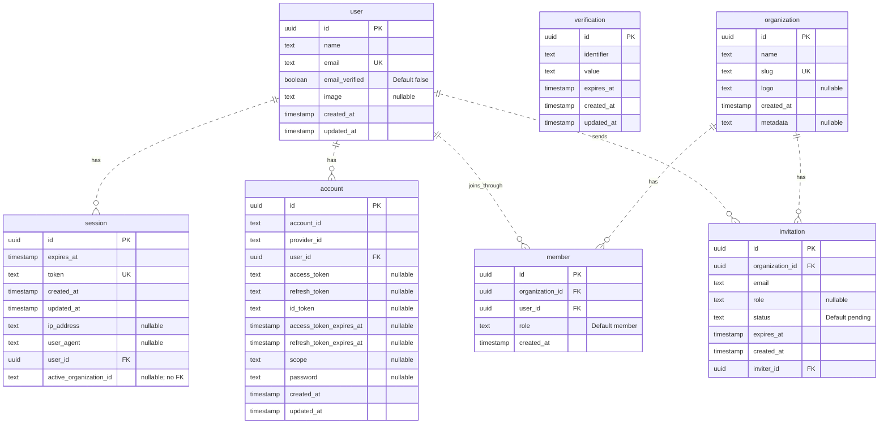
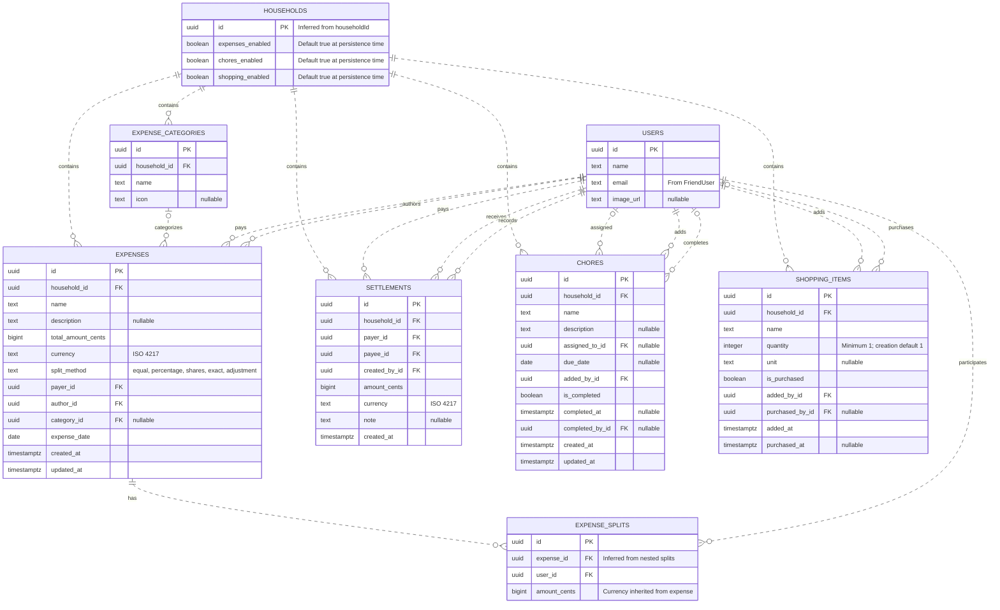
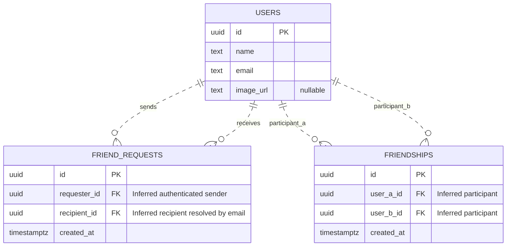

# Database schema

The current branch contains an implemented authentication/organization schema and [API contracts](../packages/contracts/src/features) for application features. The first diagram reflects the [Drizzle schema](../packages/backend/src/db/schema.ts) and [initial migration](../packages/backend/src/db/migrations/0000_petite_spyke.sql). The remaining diagrams propose relational mappings for the contracts; those application tables are not implemented yet.

`PK` = primary key, `FK` = foreign key, `UK` = unique key. Attribute comments mark nullable fields. Relationships show whether a referenced entity is required (`||`) or optional (`|o`); each referenced entity can have zero or many associated records (`o{`).

## Implemented database tables

All implemented foreign keys use `ON DELETE CASCADE`. `verification` has no foreign keys; `session.active_organization_id` is nullable text with no enforced organization reference. Timestamp columns are PostgreSQL `timestamp` without time zone. Non-unique indexes cover `session.user_id`, `account.user_id`, `verification.identifier`, both member foreign keys, and invitation organization/email. Membership pairs are not constrained to be unique.

## Proposed household data

`USERS` is a contract projection of the implemented `user` table, with `imageUrl` mapped to `image`; it is not an additional user table. `HOUSEHOLDS` represents the contract's household scope. Whether that scope maps directly to `organization`, and where its feature flags live, remain unspecified.

## Proposed friendships

The `USERS` entity below is the same table as in the household diagram. Participant IDs are inferred: the API returns the other user from the authenticated user's perspective, rather than exposing both participants.

## Mapping notes

- Nested `UserSummary` / `FriendUser` values map to user foreign keys; nested expense categories map to `category_id`. The three `HouseholdFeatures` flags are shown as proposed household boolean columns, all defaulting to enabled as documented in the contract.
- `Money` is stored as a signed integer amount in minor units plus a currency code. Split input inherits currency from the expense total, so split currency is derived when returning the API response. Expense creation requires at least one split; the response schema does not enforce a minimum array length.
- `Balance` and `SettlementSuggestion` are computed responses, not tables. Settlements record payments between users within a household and have no direct expense or split reference. Splits have no settlement state.
- Accepting a friend request removes the request and creates a friendship. There is no request status field in the current contracts.
- Organization membership and invitations already exist as `member` and `invitation`. Their mapping to the household API is not defined yet. The proposed household entity only models its inferred ID and existing feature flags. Notification contracts are empty.
- In the proposed diagrams, UUIDs, calendar dates, and UTC timestamps come from the shared contract primitives, and SQL type choices are illustrative. Application indexes, participant-pair uniqueness rules, deletion policies, and cross-household consistency checks remain unspecified. The implemented `user.email` column is already unique.

Sources: [users](../packages/contracts/src/features/users/index.ts), [households](../packages/contracts/src/features/households/index.ts), [feature catalog](../packages/contracts/src/features/catalog.ts), [expenses](../packages/contracts/src/features/expenses/index.ts), [categories](../packages/contracts/src/features/expenses/categories.ts), [settlements](../packages/contracts/src/features/expenses/settlements.ts), [chores](../packages/contracts/src/features/chores/index.ts), [shopping](../packages/contracts/src/features/shopping/index.ts), and [friends](../packages/contracts/src/features/friends/index.ts).
