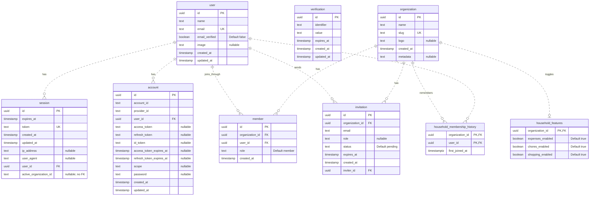
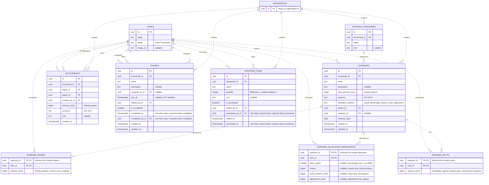
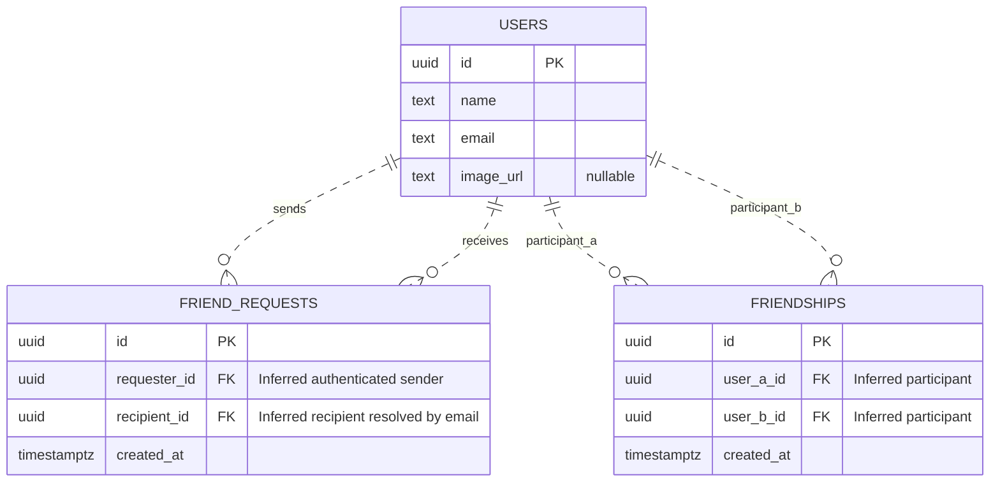
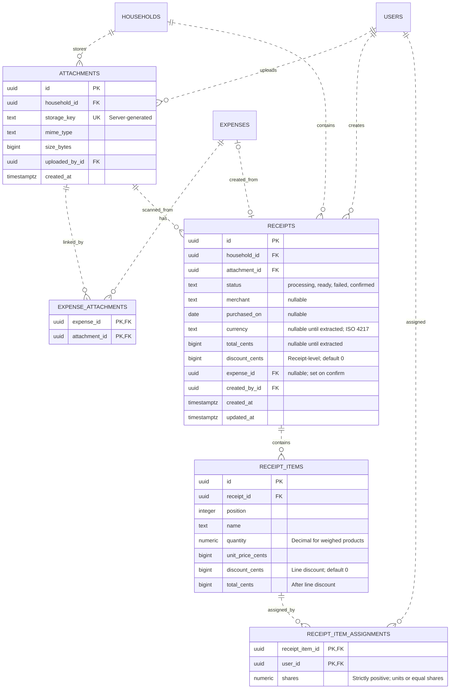

# Database schema

The current branch contains an implemented authentication/organization schema and [API contracts](../packages/contracts/src/features) for application features. The first diagram reflects the [Drizzle schema](../packages/backend/src/db/schema) and the [migrations](../packages/backend/src/db/migrations). The remaining diagrams propose relational mappings for the contracts; those application tables are not implemented yet.

`PK` = primary key, `FK` = foreign key, `UK` = unique key. Attribute comments mark nullable fields. Relationships show whether a referenced entity is required (`||`) or optional (`|o`); each referenced entity can have zero or many associated records (`o{`).

## Implemented database tables

`household_membership_history` keeps everyone who has ever been a member, after Better Auth deletes their `member` row; an `AFTER INSERT ON member` trigger fills it (see [Households API](api/households.md#storage)). Its `user_id` key is `ON DELETE RESTRICT`. `household_features` holds one row per organization with module toggles; an `AFTER INSERT ON organization` trigger seeds defaults (same doc). Every other implemented foreign key uses `ON DELETE CASCADE`. `verification` has no foreign keys; `session.active_organization_id` is nullable text with no enforced organization reference. Timestamp columns are PostgreSQL `timestamp` without time zone. Non-unique indexes cover `session.user_id`, `account.user_id`, `verification.identifier`, both member foreign keys, and invitation organization/email. Membership pairs are not constrained to be unique.

## Proposed household data

`USERS` is a contract projection of the implemented `user` table, with `imageUrl` mapped to `image`; it is not an additional user table. `HOUSEHOLDS` represents the contract's household scope as `organization.id` (`householdId`); module flags live in the implemented `household_features` table, not on `organization`. The expense child tables propose composite primary keys on `(expense_id, user_id)`; the contracts expose no payer, allocation-participant, or split IDs.

## Proposed friendships

The `USERS` entity below is the same table as in the household diagram. Participant IDs are inferred: the API returns the other user from the authenticated user's perspective, rather than exposing both participants.

## Proposed attachments and receipts

These tables support backlog tasks [4.3](backlog/tasks/4-expenses/4.3-attachments/4.3.0-epic.md) and [7](backlog/tasks/7-ai-receipts/7.0-epic.md) and have no contracts yet. `HOUSEHOLDS`, `USERS`, `EXPENSES`, and `SHOPPING_ITEMS` are the entities from the household diagram.

- Confirming a receipt creates an ordinary expense with the `exact` allocation method. Item assignments are kept on the receipt as the history of who had what, and the expense's splits remain the only source for balances.
- Item costs are split by shares, receipt-level discounts are spread over items in proportion to their cost, and per-person totals are rounded once with the allocation engine's remainder rule.
- Shopping matches from task 7.5 are request-time suggestions, not stored relations. Confirming them reuses the shopping purchase columns.

## Mapping notes

- Nested `UserSummary` / `FriendUser` values map to user foreign keys; nested expense categories map to `category_id`. The three `HouseholdFeatures` flags are shown as proposed household boolean columns, all defaulting to enabled as documented in the contract.
- `PositiveMoney` stores strictly positive expense totals and settlement payments in minor units plus a currency code. Payer contributions are also strictly positive; payer, allocation, and calculated split amounts inherit the expense currency. `Cents` / `Money` remain signed primitives for values such as balances and adjustments; the calculated split response also uses signed `Cents`.
- Expenses support multiple payers. Creation and financial replacement require at least one payer and one allocation participant, with unique users within each list; payer contributions must sum to the total. Payers and allocation participants are separate sets, so a payer need not participate in the allocation. The expense response does not require nonempty payer or calculated split arrays, and does not apply the financial spec's cross-field refinements.
- Allocation input is retained separately from calculated splits so the strategy can be returned and recalculated. `allocation.method` maps to `allocation_method`; participant `basisPoints`, `shares`, `amountCents`, and `adjustmentCents` map to the corresponding strategy-specific columns above. Equal allocation uses none of those columns. Percentage basis points must sum to 10,000, exact amounts must sum to the total, and adjustments are signed amounts added after splitting the remaining total equally; validation rejects an adjustment that yields a negative share before rounding. The proposed storage uses only the column for the selected method; rounding and persistence of calculated splits remain implementation decisions.
- Descriptive expense fields can be patched independently. Financial updates replace and validate `total`, `payers`, and `allocation` together through `financial`; persisting that replacement and recalculating splits should be atomic. Clients no longer submit calculated splits.
- `MemberBalance` / `CurrencyBalances` and `SettlementSuggestion` / `CurrencySettlementSuggestions` are computed responses, not tables. Balances and suggestions are grouped by currency, and currencies are never netted. A positive member balance means the user is owed money; a negative balance means they owe money. Settlements record strictly positive payments between distinct users within a household and have no direct expense or split reference. Splits have no settlement state.
- Chore `dueAt` is a nullable ISO 8601 UTC datetime (for example, `2026-10-06T16:00:00Z`), mapped to `timestamptz due_at`. Creation and updates may omit the deadline; an explicit null clears it. Clients convert local deadline input to UTC and display it in the user's local time zone. Date-only values are not accepted; expense `expenseDate` remains a calendar date.
- Chore completion and shopping purchase metadata follow their state flags: open chores and unpurchased items require null actor/timestamp fields; completed chores and purchased items require both fields. The conditional columns in the diagram express those contract invariants; database checks are not implemented yet.
- Accepting a friend request removes the request and creates a friendship. There is no request status field in the current contracts.
- Organization membership and invitations already exist as `member` and `invitation`. Their mapping to the household API is not defined yet. The proposed household entity only models its inferred ID and existing feature flags. Notification contracts are empty.
- Pagination and chore/shopping boolean filters now decode raw URL query strings. They are request handling concerns and introduce no persistence columns.
- In the proposed diagrams, UUIDs, calendar dates, and UTC timestamps come from the shared contract primitives, and SQL type choices and composite keys are illustrative. Application indexes, friendship participant-pair uniqueness rules, deletion policies, and cross-household consistency checks remain unspecified. The implemented `user.email` column is already unique.

Sources: [users](../packages/contracts/src/features/users/index.ts), [households](../packages/contracts/src/features/households/index.ts), [feature catalog](../packages/contracts/src/features/catalog.ts), [expenses](../packages/contracts/src/features/expenses/index.ts), [categories](../packages/contracts/src/features/expenses/categories.ts), [settlements](../packages/contracts/src/features/expenses/settlements.ts), [chores](../packages/contracts/src/features/chores/index.ts), [shopping](../packages/contracts/src/features/shopping/index.ts), [friends](../packages/contracts/src/features/friends/index.ts), [money primitives](../packages/contracts/src/common/money.ts), [pagination](../packages/contracts/src/common/pagination.ts), and [query decoders](../packages/contracts/src/common/query.ts).
